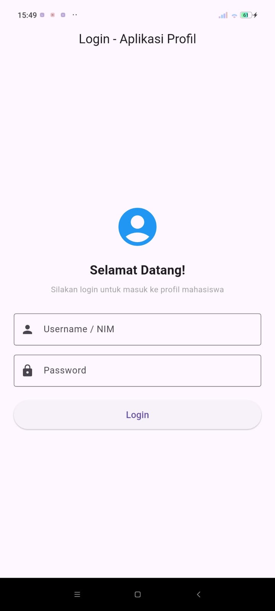
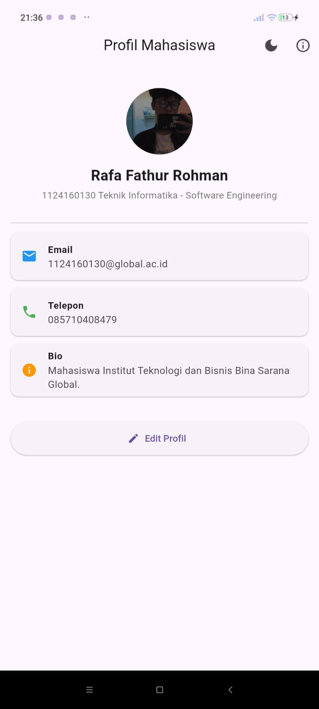
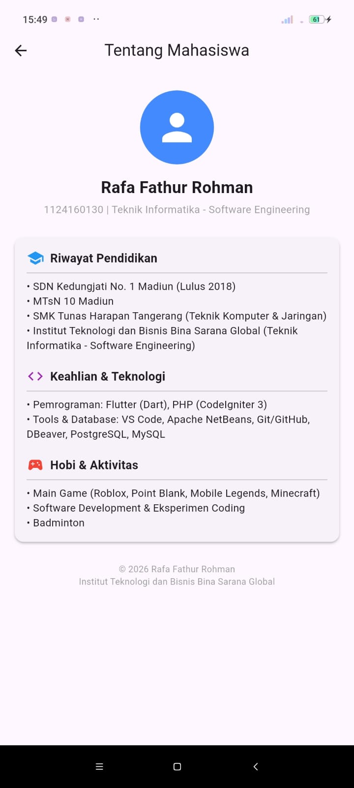
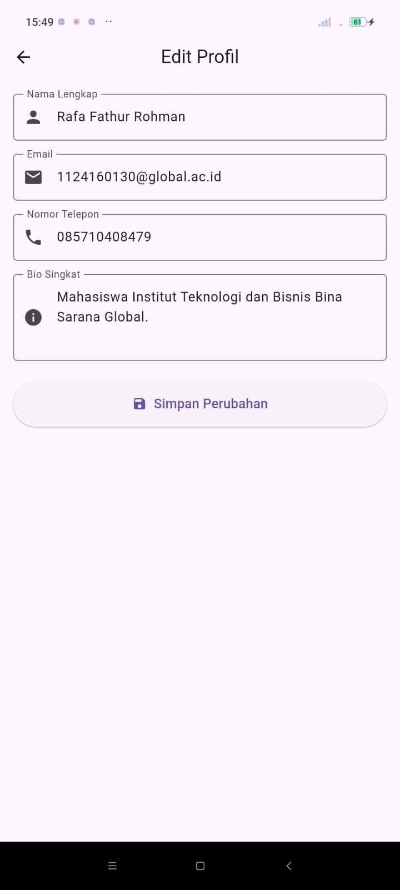

# Aplikasi Profil Mahasiswa - UTS Pemrograman Mobile

## Identitas Mahasiswa
- **Nama:** Rafa Fathur Rohman
- **NIM:** 1124160130
- **Program Studi:** Teknik Informatika (Konsentrasi Software Engineering)
- **Institusi:** Institut Teknologi dan Bisnis Bina Sarana Global

---

## Link YouTube Demo Aplikasi
- **Link YouTube:** [Tonton Video Demo Aplikasi Profil Rafa Fathur Rohman](https://youtu.be/BRMNjCF1UC8)

---

## Screenshot Aplikasi

| Halaman Login | Halaman Profil | Halaman Tentang Mahasiswa | Halaman Edit Profil |
| :---: | :---: | :---: | :---: |
|  |  |  |  |

---

## Daftar Fitur Utama
- **Autentikasi Login (`LoginPage`):** Validasi form login menggunakan NIM (`1124160130`) dan Password (`rafa`) sebelum masuk ke halaman utama via `Navigator.pushReplacement`.
- **Profil Mahasiswa (`ProfilePage`):** Menampilkan foto avatar, informasi NIM, program studi, biodata kontak, serta tombol pintasan tema (**Light / Dark Mode**) dan menu Tentang Mahasiswa di AppBar.
- **Edit Profil (`EditProfilePage`):** Formulir pembaruan data menggunakan `TextEditingController` dan `validator` form, lalu mengirimkan data terbaru kembali ke halaman profil menggunakan `Navigator.pop`.
- **Tentang Mahasiswa (`AboutPage`):** Halaman khusus di pojok kanan atas yang merangkum riwayat pendidikan lengkap (SMK Tunas Harapan Tangerang, hingga Bina Sarana Global), keahlian pemrograman, serta hobi.
- **Modular Code Structure:** Penerapan *Clean Code* dengan memisahkan model, screen, dan reusable widgets (`ProfileInfoCard`).

---

## Cara Menjalankan Aplikasi
1. Clone repository ini ke komputer lokal:
   ```bash
   git clone [https://github.com/USERNAME_GITHUB_KAMU/soal2-profil-app.git](https://github.com/rapp-afk/soal2-profil-app.git)
2. Masuk ke direktori proyek : cd UTS-PML-1124160100/soal2-profil-app
3. Unduh seluruh paket dependensi: flutter pub get
4. Jalankan aplikasi pada emulator: flutter run